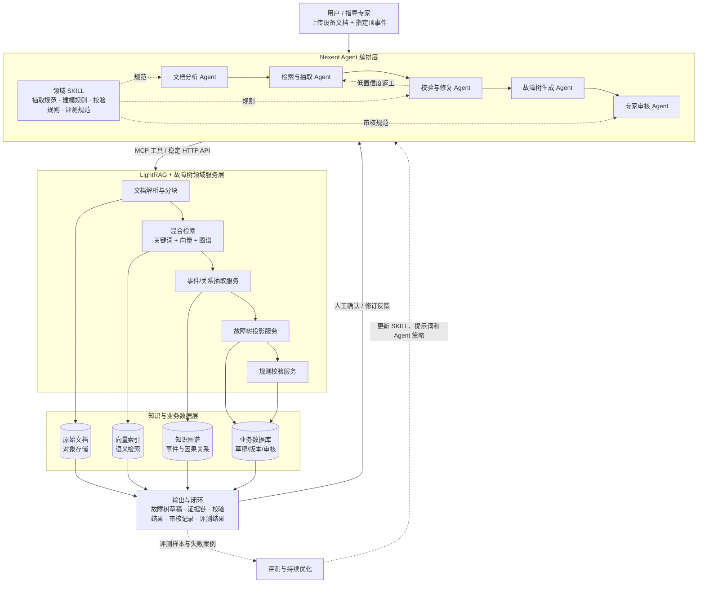

# 基于 Nexent 的工业设备故障树智能生成系统重构初步方案

## 一、项目现况

### 1. 已有成果

- 已形成“**工业文本/设备文档 → LightRAG 检索 → 故障事件与因果关系抽取 → 故障树生成 → 前端编辑 → 规则校验**”的基本闭环。
- 已将故障树领域概念写入抽取提示词，初步支持顶事件、中间事件、基本事件，以及 AND/OR 逻辑门。
- 已具备向量检索和知识图谱构建能力。
- 已实现 FastAPI 后端、React 管理界面和 Vue 故障树编辑器。
- 已有结构化故障树校验器，可检查环路、层级、孤立节点和逻辑门连接等基本问题。

### 2. 主要不足（难点）

- **长文本和多文档效果不稳定**：分块容易切断因果链，实体同义/共指没有充分消解，关系缺少原文回验。
- **数据模型没有统一**：抽取端使用三元组，编辑/校验端使用“节点-逻辑门”结构，生成结果不能直接进入校验和审核流程。
- **因果方向和门类型不够可靠**：部分方向依赖图谱恢复时的启发式推断，`resultsIn`/`jointly_resultsIn` 主要以文本字段保存，存在丢失或误判风险。
- **置信度和评测不足**：节点置信度存在硬编码，缺少可量化的统一评测指标。
- **专家辅助功能尚未实现**：目前缺少“解释—提出修改—人工确认—写回知识库”的功能。

## 二、结合华为 Nexent 平台的重构优化方案

### 总体思路

采用“**Nexent Agent 编排层 + LightRAG 检索知识层 + 故障树领域服务层**”的架构：



Nexent 不替换现有 LightRAG，而是负责 Agent 协作、工具调用、任务编排和评估；现有 LightRAG 继续承担文档处理、向量检索和知识图谱能力，故障树模块继续承担领域逻辑。

### 1. 知识库构建

- **文档分层入库**：原始设备手册/维修记录进入对象存储；解析后的章节、表格、步骤和语义片段进入检索库；故障事件、因果关系和证据进入图谱库。
- **混合检索**：结合关键词、向量和知识图谱检索，优先召回与用户指定顶事件相关的证据。
- **统一领域模型**：建立 `FaultEvent`、`FaultRelation`、`FaultTree` 三类核心对象，统一保存事件类型、因果方向、AND/OR 门、证据、置信度、版本和审核状态。
- **证据可溯源**：每个节点和关系必须关联文档、章节、片段和原文引用，避免只有结论、没有依据。
- **分阶段存储**：初期可保留现有 LightRAG 存储；后续按职责引入 PostgreSQL（任务/版本/审核）、图数据库（事件/关系）、向量库（语义检索）和对象存储（原始文件）。

### 2. 智能体构建（项目重点）

将当前单次提示词抽取改造成可复用的多 Agent 流程：

1. **文档分析 Agent**：识别章节、设备部件、故障现象、维修步骤并进行语义切分。
2. **故障事件抽取 Agent**：抽取顶事件、中间事件、底事件，并返回原文证据。
3. **因果关系 Agent**：只输出受控关系类型，明确因果方向和 AND/OR 门语义。
4. **一致性校验 Agent**：检查证据、方向、层级、同义节点、自环、重复节点和维修措施误识别。
5. **故障树生成 Agent**：将统一领域模型确定性投影为故障树草稿，接收用户明确指定的顶事件。
6. **局部修复 Agent**：只修复低置信度或校验失败的字段，避免整棵树重复生成。
7. **AI 专家辅助 Agent**：解释节点和证据，识别风险项，提出新增/删除/合并建议，提交人工审核后再写回。
8. **评估 Agent**：自动统计抽取质量、结构质量、证据覆盖率、门类型准确率和任务成本。

可考虑采用有限状态流程：

```text
抽取 → 规则检查 → 独立复核 → 评分
                  ├─ 达标：入库/生成草稿
                  ├─ 中间：局部修复后重试
                  └─ 过低：转人工审核
```

### 3. MCP 工具建设

把现有 FastAPI 能力封装为 Nexent 可调用的 MCP 工具：

- `parse_document`：解析文档并返回章节、片段和元数据；
- `search_knowledge`：按顶事件检索相关文本、实体和关系；
- `extract_fault_events`：抽取结构化故障事件及证据；
- `extract_fault_relations`：抽取有向因果关系和门类型；
- `build_fault_tree`：生成或更新故障树草稿；
- `validate_fault_tree`：执行结构、层级、逻辑和知识一致性校验；
- `query_evidence`：查询节点/关系对应原文证据；
- `submit_review`：提交专家接受、修改或拒绝结果；
- `save_draft` / `get_draft`：保存和读取可编辑版本，取消下载后再上传的串接方式。

所有工具统一使用 `FaultEvent`、`FaultRelation`、`FaultTreeDraft` 数据格式，并返回 `source`、`evidence`、`confidence`、`validation` 等字段。

### 4. SKILL 建设

将稳定的领域方法沉淀为可复用 SKILL，减少 Agent 对长提示词和人工经验的依赖：

- **工业故障树抽取 SKILL**：事件类型定义、因果关系枚举、原文证据要求和 JSON 输出规范；
- **长文档分析 SKILL**：章节级/语义级切分（或其他切分方式）、跨片段实体对齐和因果链补全；
- **故障树建模 SKILL**：三元组到 AND/OR 故障树的确定性投影规则；
- **故障树校验 SKILL**：环路、层级、孤点、门度、证据缺失和方向冲突检查；
- **专家审核 SKILL**：以待审核变更形式处理新增、删除、合并和改门操作，不直接覆盖正式知识库；
- **评测与回归 SKILL**：固定评测集、版本对比、失败样例归档和提示词/模型迭代。

## 三、预期改进效果

- 从提示词试错升级为可观测、可回退、可审核的多 Agent 流程；
- **提高长文本、多文档故障链抽取的完整性和稳定性；**
- 统一三元组、知识图谱、故障树编辑器和校验器的数据模型；
- 实现“生成—编辑—校验—审核—入库”的端到端闭环；
- 每个结论均可追溯到原文，置信度由证据、规则和复核结果共同计算；
- 为后续接入 Neo4j/Qdrant/PostgreSQL、私有化部署及生产级监控预留接口。

## 四、计划实施顺序

1. **先统一数据模型和评测指标**：明确实体类型、关系类型、证据和置信度字段。
2. **再封装 MCP 工具**：把现有检索、抽取、生成、校验能力变成稳定工具。
3. **接入 Nexent 编排最小流程**：检索 Agent → 抽取 Agent → 校验 Agent → 故障树 Agent。
4. **补充 SKILL 与专家审核**：补充行业规范，实现低置信度返工和人工二次确认。
5. **建立评测集并持续迭代**：以长文本成功率、关系方向准确率、证据覆盖率、门类型准确率和专家采纳率作为核心指标。
